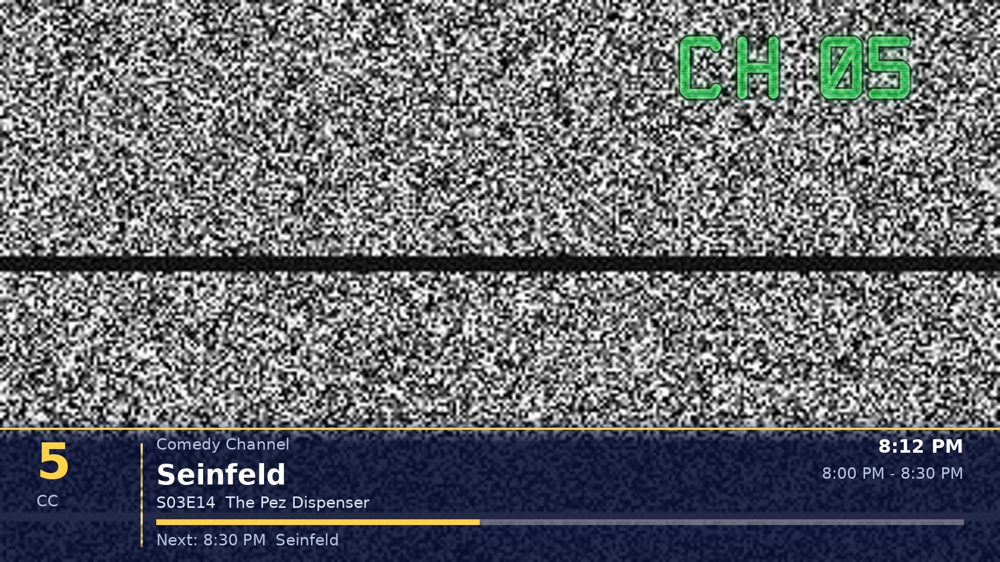
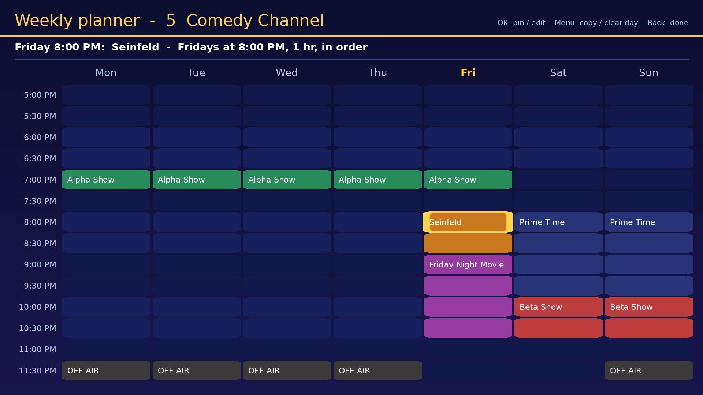

# CableBox 42

**Retro cable TV from your own Kodi library. Flip channels, not menus.**

CableBox 42 turns the movies and TV shows you already have in Kodi into a live
cable lineup. Shows air on a real clock with commercial breaks, bumpers and
station IDs. There's a scrolling program guide channel, a retro weather
channel, static between channels, a "CH 03" channel number, and a 1950s
*Please Stand By* card when a station signs off for the night. You pick up the
remote, flip to channel 5, and whatever is on is already halfway through.

It's inspired by [FieldStation42](https://github.com/shane-mason/FieldStation42),
but it's a separate implementation built for Kodi. It runs inside Kodi on
anything Kodi 21 runs on, and plays every file through Kodi's own player, so
hardware video decoding works exactly as it does for the rest of your library.

| | |
|---|---|
|  |  |
| *Changing channel: static, "CH 05" and the channel banner* | *The weekly planner: pin shows to fixed times* |
|  |  |
| *Off the air: the stand-by test card* | *The weather channel with the Full CRT effect* |

*The screenshots are put together from CableBox 42's own screen artwork and layouts.*

---

## Contents

1. [Features](#features)
2. [Requirements](#requirements)
3. [Installing](#installing)
4. [Quick start](#quick-start)
5. [Watching TV](#watching-tv)
6. [How the schedule works](#how-the-schedule-works)
7. [Building and editing channels](#building-and-editing-channels)
8. [The weekly planner](#the-weekly-planner)
9. [Commercials, bumps, station IDs and sign-off clips](#commercials-bumps-station-ids-and-sign-off-clips)
10. [Off the air](#off-the-air)
11. [The guide channel](#the-guide-channel)
12. [The weather channel](#the-weather-channel)
13. [CRT effect](#crt-effect)
14. [Home screen, Favourites and phone remotes](#home-screen-favourites-and-phone-remotes)
15. [Settings reference](#settings-reference)
16. [Video formats and AV1](#video-formats-and-av1)
17. [Files and hand-editing](#files-and-hand-editing)
18. [Troubleshooting](#troubleshooting)
19. [Credits and license](#credits-and-license)

---

## Features

- **No schedule to compile.** Lineups build themselves from your library and
  extend themselves as time passes.
- **Real-time channels.** Programs start on the hour and half hour. The time
  left over in each slot is cut into commercial breaks, just like real cable.
- **Automatic lineup builder.** One step creates a guide channel, a weather
  channel, an everything station, genre networks, decade channels, movie
  channels and studio showcases.
- **Weekly planner.** A 7-day grid for each channel. Pin shows to fixed times,
  for example *Seinfeld, Fridays 8 PM, in order*. Each pinned slot picks up
  where it left off the week before.
- **Time blocks.** Saturday-morning cartoons, prime-time movies, late-night
  blocks.
- **Off the air.** Sign-off hours with a 1950s stand-by card or colour bars,
  plus optional sign-off and sign-on clips.
- **Commercials, bumps and station IDs** from your own folders.
- **Guide channel.** A scrolling grid of what's on now and next, with promos.
- **Weather channel.** Current conditions, a text forecast, a 4-day outlook and
  the next few hours, with a ticker and optional background music.
- **The look of a CRT.** Static and a static sound between channels, a glowing
  green "CH 03" channel number, and an optional CRT effect: scanlines,
  curved-glass corners, a phosphor mask and a rolling hum bar.
- **Fine-tuning.** Move any show between channels, hide shows from a channel,
  and renumber channels with swap or slide.
- **Searchable pickers** for libraries with thousands of tags, studios or titles.
- **Works with your skin and your phone.** Home-menu widgets show what's on now,
  and you can tune from Yatse or Kore.
- **Safe on small boxes.** AV1 videos are skipped automatically on devices that
  can't decode them in hardware.

---

## Requirements

- **Kodi 21 "Omega"**, on any platform: Windows, macOS, Linux, Android,
  Android TV, Fire TV, LibreELEC, CoreELEC, OSMC or Raspberry Pi.
- **Your shows and movies scanned into the Kodi library.** CableBox reads
  titles, genres, years, studios, tags and running times from the library.
  Folders that aren't in the library can be used too; see *Programming sources*.
- **Optional:** folders of commercials, bumps, station IDs, sign-off and sign-on
  clips, and music for the guide and weather channels. You can collect these
  yourself; CableBox only ever plays files you have.

---

## Installing

**From the official Kodi repository** (once it's accepted):
*Add-ons → Install from repository → Kodi Add-on repository → Program add-ons → CableBox 42*.

**From a zip file:**

1. Download the latest `script.cablebox42-x.y.z.zip` from this repository's
   releases, or build one by zipping the `script.cablebox42` folder.
2. In Kodi: *Settings → System → Add-ons* → turn on **Unknown sources**.
3. *Settings → Add-ons → Install from zip file* → choose the zip.
4. CableBox 42 appears under *Add-ons → Program add-ons* and *Video add-ons*.

To update, install the newer zip over the top. Your channels, pinned shows and
settings are kept.

---

## Quick start

1. Open **CableBox 42** and choose **Build my lineup automatically**.
2. If you have folders of old commercials and bumps, point it at them. You can
   skip this and add them later in Settings.
3. Type your city for the weather channel, or skip it if Kodi's own weather
   service is already set up.
4. Untick any suggested channels you don't want.
5. Choose **Start watching**.

That's it. To fine-tune, use the **Channel manager**, the **Weekly planner**
and **Move shows between channels**.

---

## Watching TV

| Remote button | What it does |
|---|---|
| **CH+ / CH−**, **Up / Down**, **Page Up / Down** | Change channel, with a burst of static |
| **Number keys** | Go straight to a channel. "CH 1_" shows while you type |
| **Left** | Last channel (jump back and forth) |
| **Right** | "What's on now": every channel and its current show |
| **OK / Info** | Show or hide the channel banner (now, next, progress) |
| **Menu / Context** | What's on now, last channel, **sleep timer**, *Don't air this show here*, turn off |
| **Back / Stop** | Turn off the TV (asks first, unless you switch that off in Settings) |
| **Volume / Mute** | Work as normal |
| Pause, seek, skip | Ignored. It's live TV |

**The channel banner** slides up when you change channel. It shows the
channel number and call letters, the current show (with season, episode and
episode title), its time slot and progress, and what's on next.

**Leaving the TV.** Press Back to turn it off. If you press **Home** instead,
CableBox notices within a couple of seconds and switches itself off. It never
stops, replaces or interferes with videos you play yourself from the library.

**Sleep timer.** Menu → *Sleep timer* (15 minutes to 2 hours). There's an
optional setting to put the TV into standby through HDMI-CEC when it runs out.

---

## How the schedule works

You don't build a schedule. Each channel keeps a rolling schedule, about
12 hours ahead by default, that extends itself:

- **When you tune in**, the channel's schedule is checked and topped up.
- **While you watch**, a background helper keeps every other channel ready,
  starting with the channels next to yours.
- **While the TV is off**, Kodi's background service tops up every channel
  every 20 minutes.

What airs when:

- **Programs start on a clock.** The default is :00 and :30, which you can
  change per channel to the hour, every 15 minutes, or no clock (back to back).
- **The leftover time becomes breaks.** A 22-minute sitcom in a 30-minute slot
  gets about 8 minutes of commercial breaks, spread through the show and at the
  end. Each break ends with a bump, and the last one ends with a station ID if
  the channel has them.
- **Series play in order.** Each show continues with its next episode.
- **Lineup style:**
  - *Same show same time every day*: weekdays get the same lineup each day, and
    each weekend day has its own.
  - *Shuffle*: picks change all the time.
- **Movies** don't get cut into by default. Commercials play between films
  instead.
- **Pinned shows** from the weekly planner always start on time. Automatic
  picks never run into them.
- **No commercials?** The gaps show a short *Up next* or station card instead.

Editing a channel rebuilds its schedule from now. Episode progress is kept, so
your shows carry on where they were.

---

## Building and editing channels

### Main menu

| Item | What it's for |
|---|---|
| **Watch TV** | Turn the TV on |
| **Build my lineup automatically** | Create a lineup from your library: replace yours, or add to it |
| **Channel manager** | Add, edit, delete and renumber channels |
| **Weekly planner** | Open a channel's 7-day grid |
| **Move shows between channels** | Pick a show or movie, then tick the channels it should air on |
| **Check my videos** | Lists commercials, bumps and videos that can't be used, and why |
| **Rebuild schedules** | Plan every channel again from now (episode progress is kept) |
| **Settings** / **Help** | |

### What the lineup builder creates

| Channel | Contents |
|---|---|
| 2 – TV Guide | The scrolling program guide |
| 3 – Weather Channel | Your local forecast |
| 4 – Channel 4 | Every TV show you own: your local independent station |
| Genre networks | One per TV genre with 3 or more shows (Comedy Channel, Sci-Fi Channel, Cartoon Corner…) |
| Studio showcases | When you have enough from one studio (Disney Showcase, Hanna-Barbera Showcase…) |
| Retro 70s / 80s / 90s | TV shows from each decade |
| Movie channels | Movie Channel, one per big movie genre, and Classic Movies (before 1990) |

### Channel types

| Type | Behaviour |
|---|---|
| **Network** | Series and movies on a clock, with commercial breaks inside shows |
| **Movie channel** | Films on a clock, with commercials between them |
| **Loop** | Back to back, no clock, no breaks (good for music videos or cartoons) |
| **Guide channel** | The program guide |
| **Weather channel** | The local forecast |

### Programming sources

A channel can draw from any mix of these:

| Source | Example |
|---|---|
| TV shows from your library | *Seinfeld, Frasier, Cheers* |
| A TV genre | *Comedy* |
| TV shows from a decade | *the 1980s* |
| Movies by genre, years and/or collection | *Horror, 1980–1989* |
| A folder of videos | Each sub-folder is a show, or play the files in random or set order. Works with network shares (SMB/NFS) and USB drives |
| A Kodi smart playlist | Anything Kodi's own rule editor can express |
| A studio or network: movies and shows | *Disney* (matches "Walt Disney Pictures", "Walt Disney Productions"…) |
| A Kodi tag: movies and shows | Tag things in Kodi (*Manage → Manage tags*), then build a channel from the tag |
| Anything whose title contains… | *Christmas* |
| Specific movies | Pick them from a list |

Every long list, such as tags, studios, shows and movies, has a **Search…** row
at the top. Type a few letters to narrow it down. Lists where you can pick
several items keep your ticks across searches; press **Done** when finished.

### Channel options

Open a channel in the **Channel manager**:

| Option | Notes |
|---|---|
| Name, number, call letters, type | Numbers can be **swapped** or **slid** (see below) |
| Programming | The channel's sources |
| **Weekly planner** | Pinned shows and painted off-air hours |
| Time blocks | Different programming at certain times, e.g. *Prime Time 8–11 PM: movies* |
| Off-air hours | Sign-off times, the off-air screen, sign-off and sign-on clips |
| **What's on this channel** | A checklist of every show and movie the channel can air. Untick what doesn't belong |
| Commercials / Break into shows / Bumps | On or off for this channel |
| Lineup style | Same show same time every day, or shuffle |
| Programs start on | :00 and :30, the hour, every 15 minutes, or no clock |
| Channel commercials / bumps folder | Override the global folders for this channel |
| Station ID clips | "You're watching…" clips played between programs |
| Preview today's schedule | The next 12 hours as a list |

**Fine-tuning tips:**

- *Good Eats* landing on the Comedy Channel? Use **Move shows between
  channels**, pick *Good Eats* and tick only the channels it belongs on.
- While watching: **Menu → Don't air '…' on this channel**.

**Renumbering:** give a channel a number that's already taken, and CableBox
offers to **swap** the two or **slide** the channels in between along by one.
For example, moving Weather from 24 to 3 pushes the old 3–23 up to 4–24.
*Channel manager → Rearrange channel numbers* can also close gaps (2, 3, 4…).
Renumbering never interrupts what's airing.

---

## The weekly planner

*Main menu → Weekly planner* (or *Channel manager → a channel → Weekly planner*).

Monday to Sunday run across the screen and half-hours run down it. The line at
the top describes the slot under the cursor. Pinned shows are coloured, time
blocks are light blue, off-air hours are grey, and empty slots are filled
automatically.

| Button | Action |
|---|---|
| Arrows | Move around (the grid scrolls through the whole day) |
| Page Up / Down, CH+ / CH− | Jump 7 hours |
| **OK** on an empty slot | *Pin a show here* or *Make off-air from here* |
| **OK** on a pinned show | Change the show, start time, length, days or order; rename; **start the series over from episode 1**; remove it from one day or every day |
| **Menu** | Copy a day's pins to other days, clear a day, off-air screen and clips, preview what airs next |
| Back | Done (changes are saved as you go) |

**Pinning a show** asks four things:

1. **What:** any programming source (usually one show).
2. **How long:** *Match the show* (rounded up to the channel's slot), 30 minutes,
   1 hour, 90 minutes, 2 or 3 hours, or a custom length. If two episodes fit,
   two air back to back.
3. **Which days:** this day only, weekdays, every day, weekends, or pick days.
4. **Order:**
   - *In order*: the slot keeps its own place in the series, so Friday's
     Seinfeld continues week after week, whatever else the channel airs.
   - *Random*: any episode.

If a new pin overlaps an existing one, CableBox asks before replacing it on
the overlapping days.

A show you pin can still air at other times through the channel's automatic
programming. To keep it to its pinned slot only, untick it in **What's on this
channel**.

---

## Commercials, bumps, station IDs and sign-off clips

All of these are ordinary video files in folders you choose: local drives,
USB disks or network shares.

| Kind | Where to set it | When it plays |
|---|---|---|
| **Commercials** | Settings → Programming (global), or per channel | In breaks during and between programs |
| **Bumps** | Settings → Programming (global), or per channel | At the end of each break ("…and now back to") |
| **Station IDs** | Per channel | Right before each new program ("You're watching…") |
| **Sign-off clips** | Per channel → Off-air hours | When the channel signs off (anthem, farewell) |
| **Sign-on clips** | Per channel → Off-air hours | When the channel comes back on the air |
| **Guide / weather music** | Settings | Behind the guide and weather channels |

Tips:

- **A few dozen commercials of mixed lengths** (15, 30 and 60 seconds) fill
  breaks almost exactly. Clips longer than 10 minutes are ignored.
- CableBox reads each clip's length straight from the file, so no library scan
  is needed. It can read MP4, M4V, MOV, MKV, WebM, AVI, MPEG-TS, MPG, VOB, WMV
  and FLV.
- **Check my videos** lists clips whose length can't be read (remux them to
  .mp4 or .mkv) and AV1 clips your device can't decode.

---

## Off the air

Paint off-air hours in the **weekly planner** (OK → *Make off-air from here*)
or set them in *Channel manager → channel → Off-air hours*. Each window has a
sign-off time, a sign-on time and the nights it applies to.

While a channel is off the air it shows either:

- **A 1950s "Please Stand By" test card**, with the channel number and name in
  the centre and "Programming resumes at 7:00 AM", or
- **Colour bars**.

Optionally a **sign-off clip** plays as the channel goes off the air, and a
**sign-on clip** plays just before programming resumes. A show that's still
running at sign-off time finishes first, as on real TV.

---

## The guide channel

A scrolling grid of every channel with what's on now, in 30 minutes and in an
hour, and promos for upcoming movies and long programs. Press **OK** on the
guide to pick a channel. Add music under *Settings → Programming → Guide channel
music folder*, and change the title with *Guide title*.

Listings appear immediately. A channel whose listings are still being prepared
shows *Updating listings…* and fills in shortly afterwards.

---

## The weather channel

Pages rotate every 10 seconds:

- **Current conditions:** temperature, conditions, humidity, dew point, feels
  like, wind, pressure, UV index.
- **Local forecast:** an old-style TODAY… TONIGHT… TOMORROW… text forecast.
- **Extended forecast:** 4 days with icons, highs and lows.
- **The next few hours:** hourly temperatures and conditions, plus sunrise and
  sunset.

A conditions ticker scrolls along the bottom.

**Where the weather comes from** (*Settings → Weather*):

- **Automatic** (default): Kodi's own weather service if one is set up
  (*Settings → Services → Weather*), otherwise Open-Meteo.
- **Open-Meteo**: free, no account or key. Type a city (e.g. `Dickson, TN`) or
  `latitude,longitude`.
- Units follow Kodi's regional settings, or force °F or °C.

Add smooth jazz under *Weather channel music folder* for the full effect.

---

## CRT effect

*Settings → Viewing → CRT effect*:

| Setting | What you get |
|---|---|
| **Off** | A clean modern picture |
| **Subtle** | Fine scanlines and gently darkened corners |
| **Full** | Adds curved-glass corners, a faint phosphor stripe mask, and a slow rolling hum bar |

The effect is a set of transparent layers drawn over the picture. The video
itself isn't processed, so it stays light even on small boxes, and hardware
decoding is unaffected. The only ongoing cost is the moving hum bar, which
makes Kodi redraw its interface every frame. If you'd rather avoid that, use
Subtle.

The green **CH 03** channel number always has its own CRT styling: glow,
colour fringing, scanlines and a faint flicker.

---

## Home screen, Favourites and phone remotes

**Launching:**

- **Favourites:** on CableBox 42 in Add-ons, open the context menu → *Add to
  favourites*.
- **Skins with a customisable main menu** (Arctic Zephyr, Aeon Nox, Titan,
  Bello… via Skin Shortcuts): add a menu item with one of these actions.

| Action | Opens |
|---|---|
| `RunScript(script.cablebox42)` | The CableBox menu |
| `RunScript(script.cablebox42,watch)` | The TV, on the last channel |
| `RunScript(script.cablebox42,watch,5)` | The TV, on channel 5 |
| `RunScript(script.cablebox42,wizard)` | The lineup builder |

- **Appliance mode:** *Settings → Viewing → Turn the TV on when Kodi starts*.
  Combine it with *Go straight to TV when opened*.

**Home-screen widgets.** If your skin lets you put CableBox 42 on the home
menu and shows a preview widget of that item's content, the widget becomes a
**"what's on now" channel list**. Selecting a channel turns the TV on at that
channel.

**Phone remotes.** Yatse, Kore and other Kodi remotes work as CableBox remotes.
The channel and number buttons map to standard Kodi buttons. Browsing CableBox
42 from a remote's add-on section should show the same channel list, so you can
tap to tune. Yatse custom commands can call the `RunScript` actions above.

---

## Settings reference

**Programming**

| Setting | Default | |
|---|---|---|
| Commercials folder | – | Global commercials |
| Bumps / station ID folder | – | Global bumps |
| Commercial breaks per half hour | 2 | 0–4 |
| Guide channel music folder | – | Music behind the guide |
| Guide title | *CableBox 42 Program Guide* | |
| AV1 videos | Automatic | Automatic / Always skip / Always play (see below) |
| Schedule ahead (hours) | 12 | 6, 12 or 24 |

**Viewing**

| Setting | Default | |
|---|---|---|
| Start on channel | 0 | 0 means the last channel watched |
| Show channel banner for | 6 s | 3, 6 or 10 seconds |
| Static between channels / Static sound | On / On | |
| CRT effect | Off | Off / Subtle / Full |
| Ask before turning off | On | |
| Go straight to TV when opened | Off | Skip the CableBox menu |
| Turn the TV on when Kodi starts | Off | Only right after Kodi starts, and never if you've already started watching something else |
| Sleep timer also puts the TV in standby (CEC) | Off | |

**Weather**

| Setting | Default | |
|---|---|---|
| Weather data from | Automatic | Automatic / Kodi weather service only / Open-Meteo only |
| City or lat,lon | – | For Open-Meteo |
| Units | Automatic | Automatic / Fahrenheit / Celsius |
| Weather channel title | *Your Local Forecast* | |
| Weather channel music folder | – | |

---

## Video formats and AV1

CableBox plays whatever Kodi can play, using Kodi's own player and your
device's hardware decoding.

**AV1** is the exception worth knowing about. Many devices (for example the
ODROID N2, Raspberry Pi 4 and older Android TV boxes) can't decode AV1 in
hardware. Kodi then falls back to the CPU, which can stutter, freeze or crash.
Videos downloaded from YouTube are very often AV1.

- With *AV1 videos: Automatic*, CableBox asks the Amlogic video driver (on
  CoreELEC) whether it can decode AV1, and **skips AV1 files** if it can't.
  Other devices are assumed to cope; choose **Always skip** if yours doesn't.
- The codec comes from Kodi's library information or, for folders and clips,
  from the file's headers.
- **Check my videos** lists every AV1 file being skipped, per channel and per
  clip folder. Re-encode them to H.264 or H.265 to use them.

---

## Files and hand-editing

Everything lives in the add-on's data folder,
`userdata/addon_data/script.cablebox42/` inside Kodi's data folder:

| System | Kodi data folder |
|---|---|
| LibreELEC / CoreELEC | `/storage/.kodi/` (network share: *Userdata*) |
| Windows | `%APPDATA%\Kodi\` |
| macOS | `~/Library/Application Support/Kodi/` |
| Linux / OSMC / Raspberry Pi OS | `~/.kodi/` |
| Android | `Android/data/org.xbmc.kodi/files/.kodi/` |

| File | Contents |
|---|---|
| `channels.json` | Your lineup: channels, sources, pinned shows, time blocks, off-air hours |
| `schedules/<id>.json` | Each channel's rolling schedule and episode bookmarks (rebuilt automatically) |
| `durations.json`, `codecs.json` | Cached running times and video codecs of files |
| `state.json` | Last channel watched, weather location lookup |

**Example channel in `channels.json`:**

```json
{
  "id": "a1b2c3d4", "number": 5, "name": "Comedy Channel", "callsign": "CC",
  "type": "network", "slot": 30, "lineup": "strip",
  "commercials": true, "midroll": true, "bumps": true,
  "sources": [{"type": "tvgenre", "value": "Comedy"}],
  "exclude": ["Good Eats"],
  "slots": [
    {"id": "r1", "label": "Seinfeld", "days": [4], "start": "20:00", "minutes": 60,
     "order": "inorder", "sources": [{"type": "tvshow", "value": ["Seinfeld"]}]}
  ],
  "dayparts": [
    {"label": "Prime Time", "start": "20:00", "end": "23:00", "days": "weekends",
     "sources": [{"type": "movies", "genre": "Comedy"}]}
  ],
  "offair": [{"start": "00:00", "end": "07:00", "days": "all"}],
  "offair_style": "standby",
  "ids_path": "smb://nas/tv/station-ids/comedy/",
  "signoff_path": "smb://nas/tv/signoff/",
  "commercials_path": "smb://nas/tv/ads/80s/"
}
```

- **Days** can be `"all"`, `"weekdays"`, `"weekends"`, or a list of numbers
  (0 = Monday … 6 = Sunday).
- **Source types:** `tvshow`, `tvgenre`, `tvdecade`, `movies` (with `genre`,
  `years`, `set`, `tag`), `folder` (with `path` and `mode`: `shows`, `random`
  or `sequential`), `playlist`, `studio`, `tag`, `keyword`, `movie`.
- **Studio, tag and keyword** sources take `"what"`: `both`, `tv` or `movies`.

After editing by hand, use **Rebuild schedules** in the menu. Keep a copy of
the original first.

---

## Troubleshooting

**A channel shows "No programming."** Its sources found nothing. Check that
your media is scanned into the Kodi library, then check the channel's
*Programming*.

**A channel shows "Technical difficulties."** A file wouldn't play: it may be
missing, or on a network share that's offline. CableBox moves on when the next
item starts.

**Breaks show "Up next" cards instead of commercials.** No commercials folder
is set, or none of its clips could be read. Run **Check my videos**.

**A video plays sound but no picture, or Kodi freezes or crashes on certain
videos.** It's very likely AV1 on a device without AV1 hardware decoding. See
[Video formats and AV1](#video-formats-and-av1).

**The CableBox menu opens by itself at startup or after a movie.** Update to
1.3.2 or later. Older versions didn't understand the content requests that some
skins make for add-ons placed on their home menu.

**The guide says "Updating listings…"** That's normal right after installing or
updating. Listings appear within a minute or two as each channel is prepared.

**Pinned shows don't appear yet.** Changes apply from now. Open *Preview
today's schedule*, or use *Rebuild schedules*.

**Getting a log for a bug report:**

1. Turn on *Settings → System → Logging → Enable debug logging*.
2. Reproduce the problem.
3. Send the `kodi.log` (and `kodi.old.log` if Kodi restarted). On
   LibreELEC/CoreELEC they're in the *Logfiles* network share or
   `/storage/.kodi/temp/`.

CableBox's lines are tagged `script.cablebox42`.

Please report issues at
<https://github.com/SeadogMcGrog/script.cablebox42/issues> with your Kodi
version, device, what you were doing, and the log.

---

## Credits and license

Created by **Seadog McGrog**.

Inspired by [FieldStation42](https://github.com/shane-mason/FieldStation42) by
Shane Mason, which pioneered this channel-flipping way of watching your own
media. CableBox 42 is a separate implementation for Kodi and contains no
FieldStation42 code. It is not affiliated with that project.

All artwork in this add-on (test card, channel digits, backgrounds, CRT
overlays) is original. CableBox 42 plays only media you provide.

Licensed under the **Mozilla Public License 2.0**; see [LICENSE.txt](LICENSE.txt).
